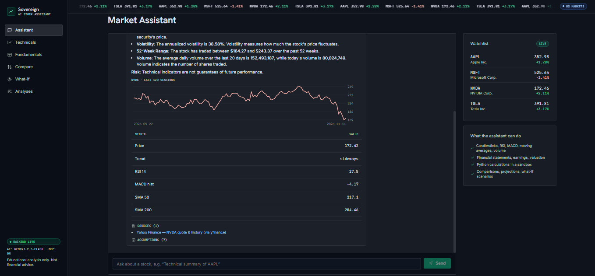
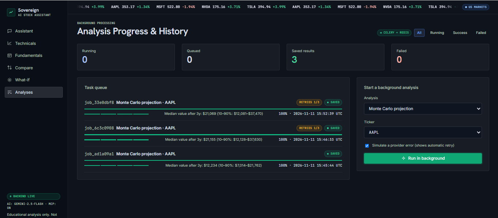
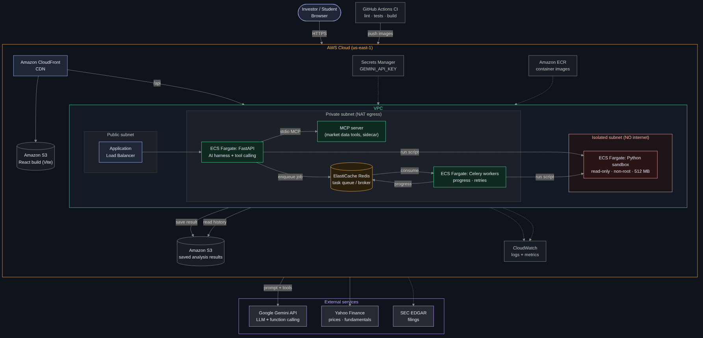

# AI Stock Market Assistant

An AI stock market assistant that brings together market data, company research and analysis in one conversational interface.

> Educational project. Nothing here is financial advice.

## Features

| Area | What it does |
|---|---|
| Technical analysis | Candlestick charts, SMA 20/50/200, RSI, MACD, volume, trend detection |
| Fundamental analysis | Income statements, earnings vs estimates, valuation ratios, margins |
| Calculations | Python-powered comparisons, projections and what-if scenarios (sandboxed) |
| Explanations | Chat answers with tables, charts, **sources and assumptions** on every result |
| Background jobs | Celery workers + Redis queue with progress tracking, retries and saved results |

## Tech stack

- **Frontend:** React (Vite), Framer Motion, TradingView lightweight-charts. Design system: *Institutional Sovereign*
- **Backend:** Python FastAPI, tool calling, AI harness (Google Gemini)
- **Data:** MCP server for market data and company information (yfinance, SEC EDGAR)
- **Workers:** Celery + Redis
- **Sandbox:** isolated Docker container for analysis scripts

## Project structure

```
ai-stock-market-assistant/
├── frontend/          React app (Vite)
│   └── src/
│       ├── api/       API client (mock in Hissa A)
│       ├── components/ UI kit, charts, layout
│       ├── data/      demo data
│       ├── lib/       indicators + formatting
│       ├── pages/     Chat, Technicals, Fundamentals, Compare, What-if, Analyses
│       └── styles/    design tokens + global CSS (animations)
├── backend/           FastAPI API, AI harness, MCP server, Celery worker
├── sandbox/           isolated Python sandbox (Docker) + analysis scripts
├── docs/              deliverables (Miro, Jira, architecture, presentation)
├── .github/           CI workflow (lint + tests + build) and PR template
├── docker-compose.yml redis + sandbox + backend + worker + frontend
├── .env.example       copy to .env and add your keys
└── README.md
```

## Setup (Windows)

1. Copy `.env.example` to `.env` (project root) and add your free Gemini key.
2. Start the backend (terminal 1):

```bash
cd backend
python -m venv .venv
.venv\Scripts\activate
pip install -r requirements.txt
python -m uvicorn app.main:app --port 8000
```

3. Start the frontend (terminal 2):

```bash
cd frontend
npm install
npm run dev
```

Open http://localhost:5173 (app) and http://localhost:8000/docs (API).
If the backend is offline the UI automatically shows demo data with a **DEMO DATA** badge.

Without Docker, background jobs run in a local worker thread and the sandbox runs as an isolated
subprocess, so everything works on a plain Windows laptop.

### Option B: everything in Docker (Redis + Celery + sandbox container)

```bash
docker compose up --build
```

| Service | What it does |
|---|---|
| `redis` | task queue / broker for Celery |
| `worker` | Celery worker: long analyses with progress, 3 automatic retries, saved results |
| `sandbox` | Python sandbox: no internet, read-only filesystem, non-root, 512 MB RAM, 1 CPU |
| `backend` | FastAPI + AI harness + MCP market-data server |
| `frontend` | React app (Vite) |

### Option C: Celery worker on Windows without Docker for the app

```bash
docker run -d -p 6379:6379 redis:7-alpine          # Redis only
cd backend && .venv\Scripts\activate
celery -A app.worker worker --pool=solo --loglevel=info
```

## Deployment (free)

| Part | Host | Notes |
|---|---|---|
| **Frontend + backend together** | **Hugging Face Spaces (Docker, free CPU basic)** | Root `Dockerfile` builds React and serves it from FastAPI on port 7860: one URL for everything. Add `GEMINI_API_KEY` as a Space secret. |
| Frontend | Vercel (Hobby, free) | Root directory `frontend`, env `VITE_API_URL` = Render URL. `vercel.json` handles page refresh on routes. |
| Backend | Render (free web service) | Blueprint `render.yaml`. Free service sleeps after 15 min idle (first request 30-60 s). |
| Jobs + sandbox | Same Render service | Free plan has no worker/Redis, so `JOBS_MODE=local` and the sandbox runs as an isolated subprocess. |
| Full Celery + Redis + Docker sandbox | Local `docker compose up` (or a paid worker) | Shown in the live demo. |

## Tests and checks

```bash
cd backend && pytest -q        # 16 tests: indicators, harness, sandbox safety, jobs + retries
cd frontend && npm run lint && npm run build
```

GitHub Actions runs backend lint + tests, frontend lint + build, and Docker image builds on every pull request.

## Screenshots

| Assistant (live NVDA answer) | Analyses (Celery + Redis, retry, saved result) |
|---|---|
|  |  |

_Add more screenshots (Technicals, Fundamentals, Compare, What-if) to `docs/screenshots/`._

## Deliverables

| Deliverable | File |
|---|---|
| Miro board content (research, journeys, wireframes, system flow) | [docs/miro/MIRO_BOARD.md](docs/miro/MIRO_BOARD.md) |
| Jira import (8 epics, 18 stories, 20 tasks) | [docs/jira/jira_import.csv](docs/jira/jira_import.csv) |
| AWS-style architecture (draw.io / PNG / Mermaid) | [docs/architecture/](docs/architecture/) |
| Presentation with speaker notes | [docs/presentation/AI_Stock_Market_Assistant.pptx](docs/presentation/AI_Stock_Market_Assistant.pptx) |
| Import guide (Miro, Jira, draw.io) | [docs/HOW_TO_IMPORT.md](docs/HOW_TO_IMPORT.md) |
| Brief checklist | [docs/FINAL_CHECKLIST.md](docs/FINAL_CHECKLIST.md) |



## Contributing

Work happens on feature branches (`feature/...`) and is merged into `main` through pull requests. See [CONTRIBUTING.md](CONTRIBUTING.md).
