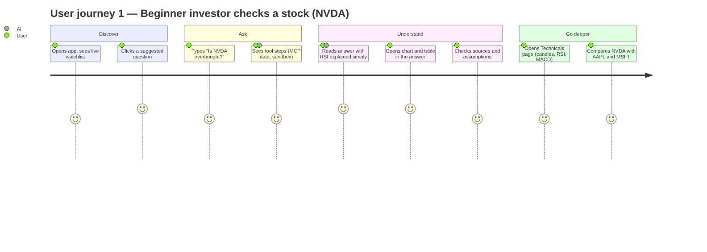
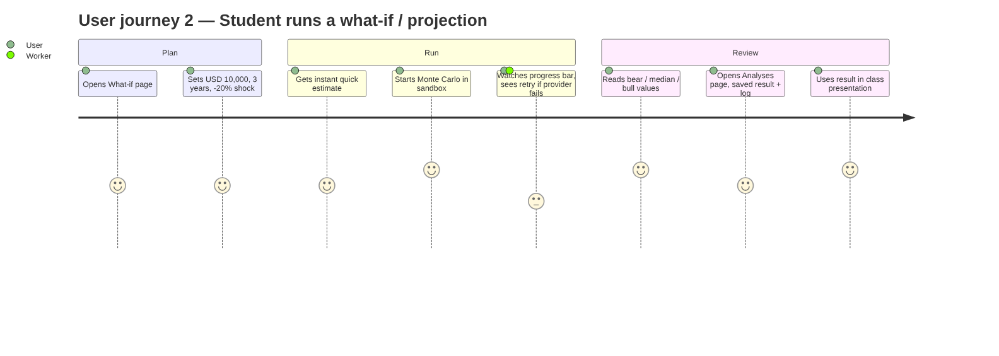
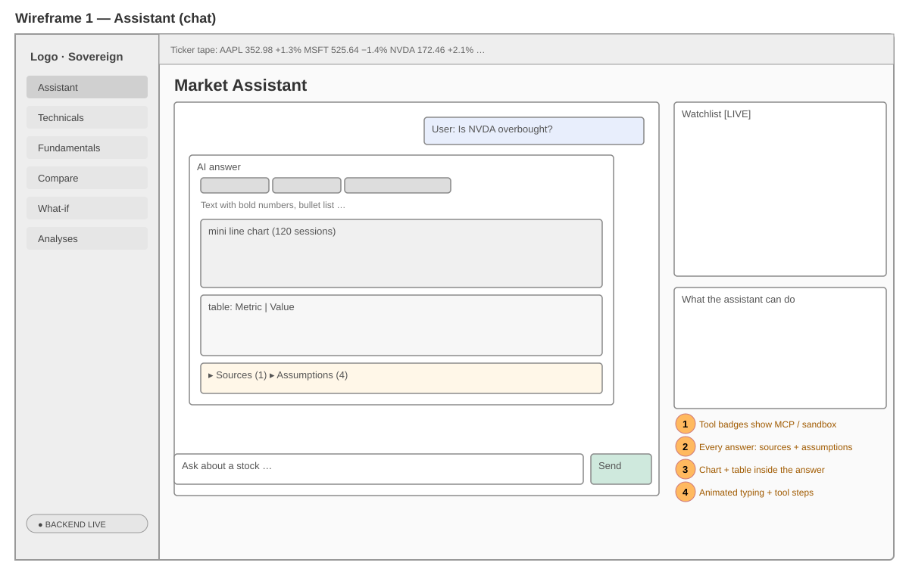
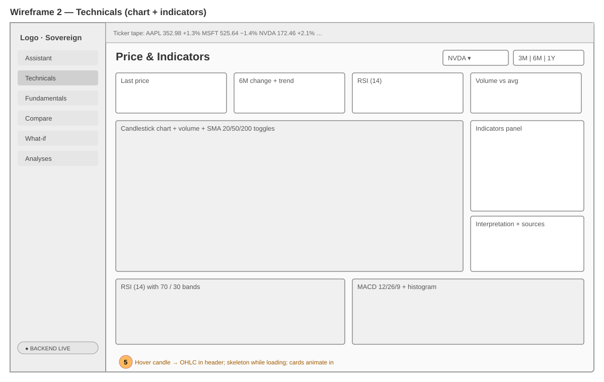
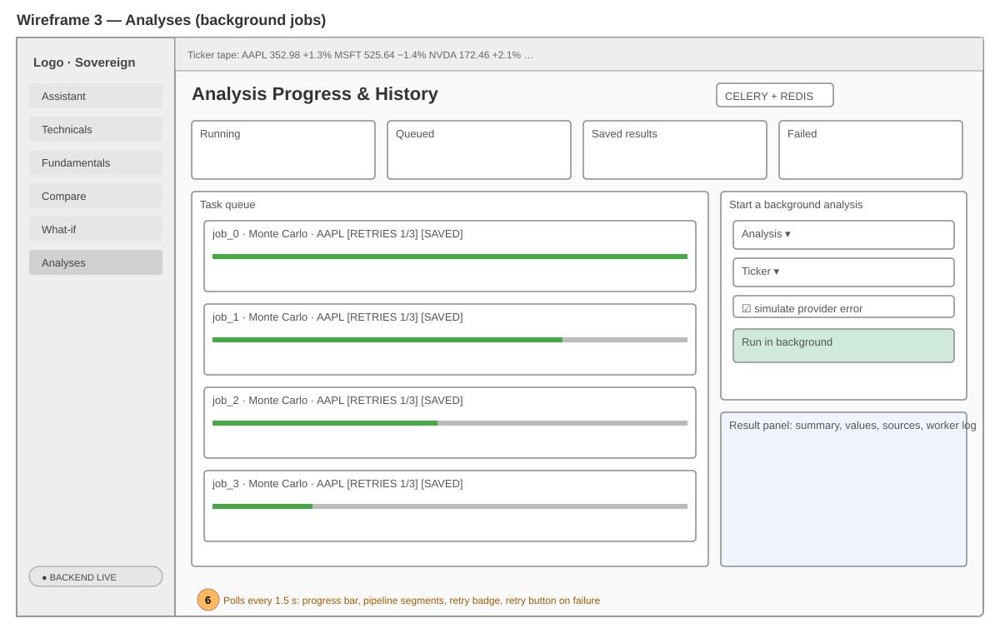
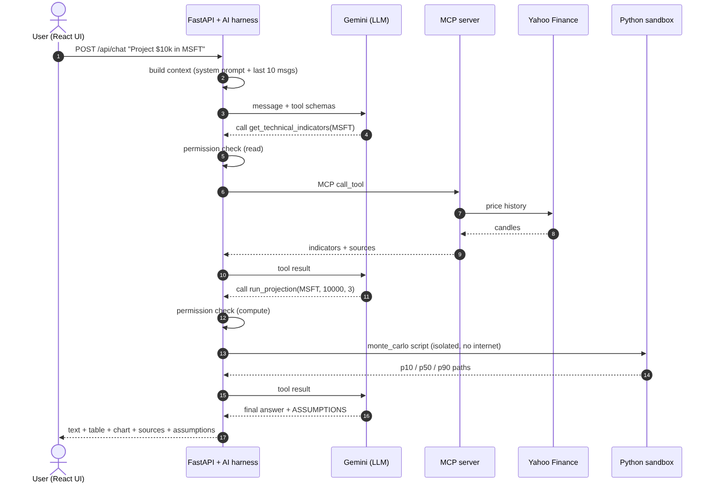
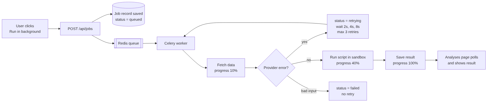
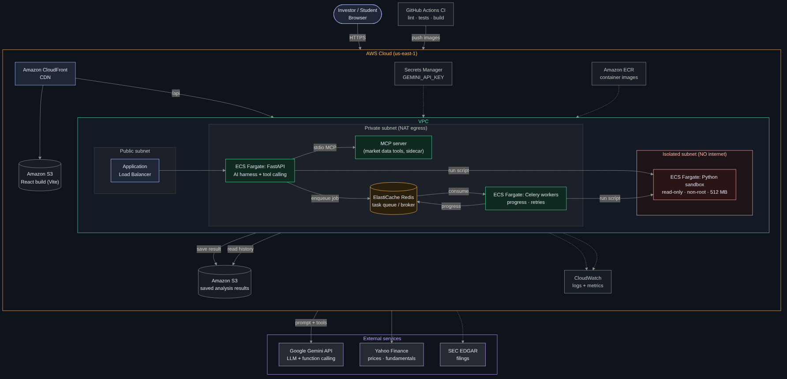

# Miro board — AI Stock Market Assistant

Board layout: **4 frames, left to right**: 1 Research → 2 User journeys → 3 Wireframes → 4 System flow.
Sticky-note text for every frame is in `miro_stickies.csv` (one column per frame). Images are in `images/`.

---

## Frame 1 — Research

### Problem
Retail investors and students jump between many tools: a charting site for candles, a finance site for
statements, a spreadsheet for calculations, and a chatbot that cannot see live data. Answers rarely show
where the numbers came from or which assumptions were made.

### Goal
One conversational interface that brings market data, company research and analysis together, with
charts, tables, sources and assumptions on every answer.

### Target users (personas)
| Persona | Need | Pain today |
|---|---|---|
| **Ayesha, beginner investor (24)** | "Is this stock expensive or risky?" in plain words | Jargon (RSI, P/E), too many tabs |
| **Bilal, finance student (21)** | Comparisons, projections and what-if numbers for assignments | Manual spreadsheets, no reproducible method |
| **Sara, part-time trader (32)** | Quick technical read (trend, RSI, MACD, volume) | Charting tools don't explain, chatbots don't have data |

### Competitor / alternative scan
| Tool type | Strength | Gap we fill |
|---|---|---|
| Charting platforms | Excellent candlestick charts and indicators | No conversational explanation, no fundamentals in context |
| Finance portals | Statements, earnings, news | Raw tables, no analysis or what-if |
| Spreadsheets | Flexible calculations | Manual, error-prone, no live data |
| General AI chatbots | Natural language | No live market data, numbers can be invented, no sources |

### Key insights
1. Users trust numbers more when **sources and assumptions** are shown next to them.
2. Beginners need **one-line meaning** for every indicator ("RSI above 70 = rose fast, pullback risk").
3. Heavy calculations (Monte Carlo, backtests) take time, so they need **progress, retries and saved results**.
4. Running AI-written code must be **isolated** (sandbox) for safety.

### Scope (MVP)
US stocks (AAPL, MSFT, NVDA, TSLA + any US ticker) · daily data · educational use, not financial advice.

---

## Frame 2 — User journeys

| Stage | Journey 1: beginner checks NVDA | Journey 2: student runs a projection |
|---|---|---|
| Trigger | Heard NVDA fell, wants to know if it's "cheap" | Assignment: value of USD 10k after 3 years |
| Action | Asks the assistant, reads RSI/MACD explanation | Sets inputs on What-if, runs Monte Carlo in sandbox |
| System | Gemini calls MCP tools → Yahoo data → indicators | Celery job → sandbox script → saved result |
| Output | Answer + chart + table + sources + assumptions | Bear / median / bull values + saved job + log |
| Emotion | Confused → confident | Unsure → has a reproducible result |
| Opportunity | Link to Technicals page for deeper view | Export/use result in presentation |

---

## Frame 3 — Wireframes

Design system: **Institutional Sovereign**. Dark canvas `#0f131c`, emerald `#4edea3` = gains/primary,
`#ffb4ab` = losses, amber `#ffb95f` = warnings/pending, indigo `#adc6ff` = info. Hanken Grotesk headings,
Inter body, JetBrains Mono for all numbers (tabular). 4 px radius cards, 1 px borders, 44 px table rows.

---

## Frame 4 — System flow

Steps of one chat request:
1. React UI sends the question + last 10 messages to FastAPI.
2. The **AI harness** builds context and sends the question with tool schemas to Gemini.
3. Gemini asks for tools; the harness checks **permissions** (read / compute) and a 6-call budget.
4. Read tools go through the **MCP server** → Yahoo Finance. Compute tools go to the **Python sandbox**.
5. Results return to Gemini, which writes the answer and its assumptions.
6. The harness attaches **sources, assumptions, a table and chart data**, and the UI renders them.

Long analyses go to **Redis → Celery worker** with progress, up to 3 retries (2 s, 4 s, 8 s) and saved results.
